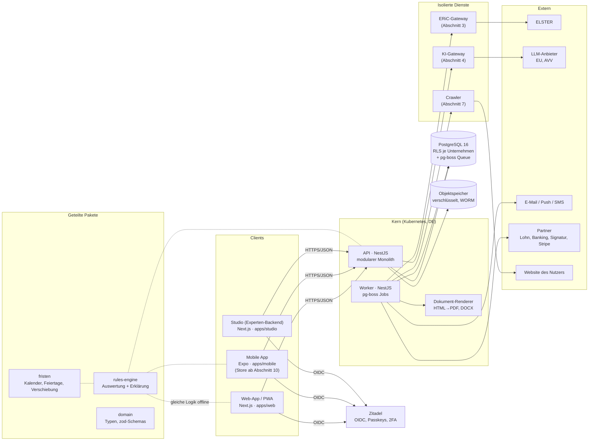
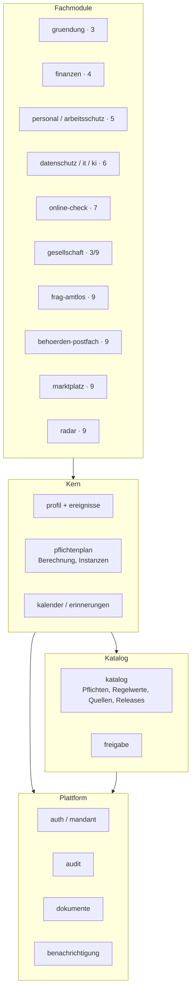
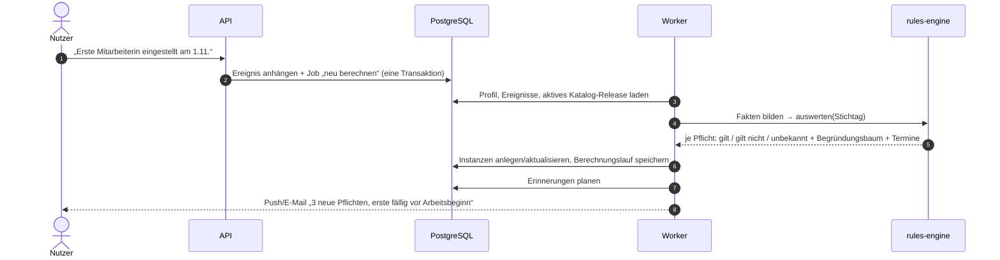
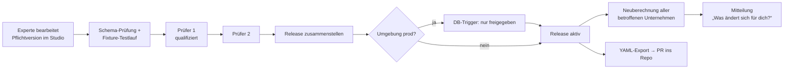

# 01 · Systemarchitektur

Stand: 2026-10-11 · Entscheidungen dazu: `ENTSCHEIDUNGEN.md` (E-010 bis E-020)

## Überblick

Amtlos ist ein **modularer Monolith** (NestJS) mit einem Web-Frontend für Nutzer, einem internen Studio für Experten und wenigen isolierten Diensten für riskante Aufgaben (native ELSTER-Bibliothek, fremde Websites, LLM-Aufrufe). Alles läuft in Deutschland.



## Komponenten

| Komponente | Aufgabe | ab Abschnitt |
|---|---|---|
| `apps/web` | Nutzer-App: Onboarding, Heute, Pflichten, Kalender, Dokumente, später alle Module. PWA mit Offline-Speicher. | 1 |
| `apps/studio` | Experten-Backend: Regel-Editor, Fixtures-Testlauf, Freigaben, Releases, Radar, Vorlagen, Mitteilungen. Eigene Domain, nur Plattformrollen. | 1 |
| `apps/api` | REST-API (OpenAPI-Spezifikation generiert), Auth-Prüfung, Mandantenkontext, Fachmodule. | 1 |
| `apps/worker` | Jobs: Neuberechnung, Erinnerungen, Benachrichtigungen, Dokument-Erzeugung, Release-Rollout, ICS. | 1 |
| `apps/mobile` | Expo-App, geteilte Pakete. | Gerüst 1, Store 10 |
| `services/renderer` | HTML→PDF (Chromium-basiert, ohne Netz), DOCX-Erzeugung. | 1 |
| `services/eric-gateway` | Kapselt die ERiC-Bibliothek; einziger Weg zu ELSTER. | 3 |
| `services/crawler` | Headless-Browser für Online-Check, eigenes Netzsegment, keine Datenbankrechte. | 7 |
| `services/ki-gateway` | Einziger Ausgang zum LLM; Protokoll, PII-Maskierung, Quellenbindung, Validierung. | 4 |

## Fachmodule in der API

Jedes Modul besitzt seine Tabellen und spricht mit anderen Modulen nur über deren öffentliche Services. Abhängigkeiten zeigen nur nach unten.



## Kernablauf: vom Ereignis zur Pflicht



Neuberechnung wird ausgelöst durch: neues Ereignis, neue Profilversion, neues Katalog-Release, Tageswechsel (nur Periodenfortschreibung, keine Neuauswertung der Bedingungen), Schwellenüberschreitung aus Finanzdaten (ab Abschnitt 4).

Jeder Lauf ist **reproduzierbar**: Gespeichert werden Release-Nummer, Profilversion, Stichtag und Fakten-Hash. Damit lässt sich später nachweisen, warum Amtlos an einem Tag eine bestimmte Aussage gemacht hat.

## Katalog-Lebenszyklus



## Monorepo-Struktur

```
amtlos/
├─ apps/
│  ├─ web/            Next.js App Router, Nutzer-App, PWA
│  ├─ studio/         Next.js, Experten-Backend
│  ├─ api/            NestJS
│  ├─ worker/         NestJS standalone, pg-boss
│  └─ mobile/         Expo
├─ services/
│  ├─ renderer/
│  ├─ eric-gateway/
│  ├─ crawler/
│  └─ ki-gateway/
├─ packages/
│  ├─ rules-schema/   JSON-Schemas: Pflicht, Regelwert, Fakten-Katalog
│  ├─ rules-engine/   Auswertung, Erklärung, Fakten-Herleitung
│  ├─ fristen/        Termin- und Periodenberechnung, Feiertage, Bankarbeitstage
│  ├─ domain/         zod-Typen, API-Verträge
│  ├─ ui/             Designsystem (Tailwind, Radix-Primitives), WCAG 2.2 AA
│  ├─ i18n/           Übersetzungsdateien DE/EN
│  └─ config/         eslint, tsconfig, tailwind preset
├─ catalog/
│  ├─ pflichten/      YAML je Pflicht (Export aus Studio, Startbestand)
│  ├─ regelwerte/
│  ├─ fixtures/       Profil-Fixtures je Persona und Grenzfall
│  └─ quellen.yaml
├─ db/
│  ├─ migrations/     SQL-Migrationen, 0001 = Referenzschema (siehe 02-datenmodell)
│  ├─ migrieren.mjs   Migrations-Runner mit Prüfsummen
│  └─ tests/
├─ infra/             OpenTofu, Helm-Charts
├─ docs/
├─ ENTSCHEIDUNGEN.md
└─ PRUEFLISTE.md
```

## Sicherheit (Querschnitt)

- **Transport/Ruhe:** TLS 1.3 überall, Datenbank- und Objektspeicher-Verschlüsselung; besonders schützenswerte Felder (Steuer-ID, Gesundheitsdaten im Datenschutzmodul, Bankdaten) zusätzlich anwendungsseitig verschlüsselt (Envelope Encryption, Schlüssel im KMS des Anbieters).
- **Mandantentrennung:** RLS (siehe 02), App-Rolle ohne Eigentümerrechte, Integrationstests „Mandant A sieht nichts von B“ für jede Tabelle als CI-Pflicht.
- **Audit:** jede schreibende Aktion in `audit.ereignis` mit Hash-Kette (manipulationsevident).
- **Rollen:** Plattformrollen erhalten keinen Mandantenzugriff. Support-Zugriff nur über zeitlich begrenzte, vom Inhaber freigegebene Sitzung, im Audit-Log sichtbar.
- **Isolation:** Crawler und Renderer ohne Datenbank-Zugangsdaten; ERiC-Gateway ohne allgemeinen Internetzugang.
- **Lieferkette:** Lockfiles, Renovate, SBOM pro Build, Container-Signaturen.

## Qualität und Betrieb

- **Tests:** Engine und Fristen mit Fixtures je Persona und Grenzfall (Umsatz exakt an Schwelle, Fristende am Feiertag, Schaltjahr, Jahreswechsel); RLS-Tests; E2E (Playwright) der Kernflüsse; axe-Tests je Seite; Lasttest der Neuberechnung (Ziel: Release-Rollout für 100.000 Unternehmen < 30 min).
- **CI/CD:** GitHub Actions → Container-Registry in DE → staging automatisch, prod nach Freigabe.
- **Betrieb:** 99,9 % Uptime-Ziel, tägliche Backups plus Point-in-Time-Recovery, monatlicher Wiederherstellungstest.
