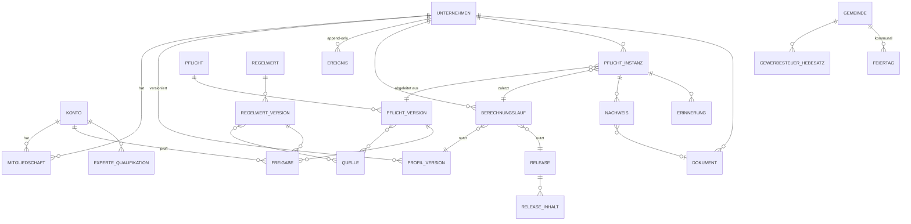

# 02 · Datenmodell

Stand: 2026-10-11 · Entscheidungen: E-012, E-018, E-030 bis E-039

Das Modell hat zwei Ebenen:

1. **Physisch, ausführbar und getestet** für Abschnitt 1–2: `db/schema.sql` (PostgreSQL 16) mit 30 automatisierten Prüfungen in `db/tests/` (Mandantentrennung, Rollen, Vier-Augen-Freigabe, prod-Gate, Unveränderlichkeit, Audit).
2. **Logisch** für alle Module ab Abschnitt 3: Entitäten, Schlüsselattribute und Beziehungen. Sie werden im jeweiligen Abschnitt als Migration umgesetzt, nach denselben Mustern.

## Muster, die überall gelten

| Muster | Regel |
|---|---|
| Mandant | Jede mandantenbezogene Tabelle hat `unternehmen_id` und die RLS-Policy `mandant`. Ausnahme nur mit Eintrag in `ENTSCHEIDUNGEN.md`. |
| Versionierung | Fachlich relevante Stände werden als neue Version angelegt, nie überschrieben (`profil_version`, `pflicht_version`, `regelwert_version`, `vorlage_version`). |
| Append-only | Ereignisse, Zeitbuchungen, Unterschriften, Audit: nur `insert`; Korrektur über Storno-Eintrag. |
| Freigabe | Katalog-Inhalte haben `pruef_status`; `freigegeben` nur über Vier-Augen-Freigabe (Trigger). Freigegebene Versionen sind unveränderlich. |
| Dateien | Nie in der Datenbank. `dokument` hält Objekt-Schlüssel, SHA-256, Größe, MIME, Aufbewahrungsfrist. |
| Zeit | `timestamptz` für Zeitpunkte, `date` für Fristen und Gültigkeiten (Fristen sind Kalendertage, keine Uhrzeiten). |
| Geld | `numeric(14,2)` in EUR; nie Gleitkomma. |
| Sprache | Katalogtexte als `jsonb { de, en }`; Nutzerdaten in der Sprache, in der sie eingegeben wurden. |

## Kern (Abschnitt 1–2) – physisch



### Tabellen

**Schema `katalog` (global, kein Mandant)**

| Tabelle | Zweck | Wichtige Regeln |
|---|---|---|
| `pflicht` | stabile ID je Pflicht | ID-Format `kategorie.name` |
| `pflicht_version` | vollständiges Pflicht-Dokument (`daten jsonb`) + indizierte Spalten | `daten.id/version` = Spalten; unveränderlich nach Freigabe |
| `regelwert`, `regelwert_version` | Schwellen, Beträge | freigegebene Gültigkeiten überlappen nicht (Exclusion-Constraint) |
| `quelle`, `*_version_quelle` | Quellen mit Abrufdatum und Archivkopie | `abgerufen_am` null = noch nicht abgerufen |
| `vorlage`, `vorlage_version` | Dokumentvorlagen je Sprache und Format | wie Pflichten freigabepflichtig |
| `experte_qualifikation` | Steuerberater, Rechtsanwalt, Sifa, DSB | mit Nachweis und Ablaufdatum |
| `freigabe` | Prüfentscheidungen | Autor ≠ Prüfer; Qualifikation muss hinterlegt sein |
| `release`, `release_inhalt` | ausgerollter Katalogstand | in prod nur Freigegebenes; veröffentlicht = unveränderlich |
| `radar_eintrag` | Rechtsänderungen in Entwurf/Planung | Wahrscheinlichkeit, erwartetes Datum, Vorbereitung |
| `gemeinde`, `gewerbesteuer_hebesatz`, `feiertag`, `bankarbeitstag_ausnahme` | Stammdaten | Feiertage bundesweit, je Land, je Gemeinde |

**Schema `app` (Mandant, RLS)**

| Tabelle | Zweck | Wichtige Regeln |
|---|---|---|
| `konto` | Person (aus Zitadel) | sieht sich selbst und Mitglieder des aktuellen Unternehmens; Anlage nur über `konto_anmelden()` |
| `konto_plattform_rolle` | Experte, Redaktion, Admin, Support | gibt keinen Mandantenzugriff |
| `unternehmen` | Mandant | Anlage nur über `unternehmen_anlegen()`, Anlegender wird Inhaber |
| `mitgliedschaft` | Konto × Unternehmen × Rolle | Verwalten nur durch Inhaber/Admin im aktuellen Unternehmen |
| `einladung` | E-Mail-Einladung mit gehashtem Token | |
| `profil_version` | Unternehmensprofil als `jsonb`, generierte Spalten für Rechtsform, Land, Gemeinde | jede Änderung = neue Version |
| `ereignis` | „erste Einstellung“, „Kasse angeschafft“ … | append-only, `client_id` für idempotenten Offline-Upload |
| `berechnungslauf` | Release, Profilversion, Stichtag, Fakten, Hash, Engine-Version | macht jede Aussage reproduzierbar |
| `pflicht_instanz` | eine Pflicht in einer Periode | eindeutig je (Unternehmen, Pflicht, Periode); erledigt nur mit Zeitpunkt und Version |
| `pflicht_instanz_anzeige` (View) | berechnet `ueberfaellig`, `faellig_bald`, `angabe_fehlt` | E-035 |
| `nachweis` | Upload, Übermittlungsprotokoll, Bestätigung | |
| `dokument` | Metadaten zu Dateien im Objektspeicher | `aufbewahrung_bis` → WORM |
| `erinnerung`, `benachrichtigung`, `benachrichtigung_einstellung`, `kalender_abo` | Fristen-Kommunikation | ICS-Token nur gehasht |

**Schema `audit`**: `ereignis` mit Hash-Kette über alle schreibenden Aktionen auf Kern- und Katalogtabellen. Für die App-Rolle nicht lesbar; Einsicht für Nutzer über eine gefilterte API („Wer hat was geändert“).

### Kontext und Rollen in der Datenbank

```sql
-- pro Request in einer Transaktion, durch die API
select set_config('amtlos.konto_id',      $1, true);
select set_config('amtlos.unternehmen_id', $2, true);
```

| DB-Rolle | Nutzung | darf |
|---|---|---|
| `amtlos_owner` | Migrationen | alles; nicht von Diensten genutzt |
| `amtlos_app` | API, Worker | `app.*` unter RLS lesen/schreiben, `katalog.*` lesen, kein `audit` |
| `amtlos_studio` | Studio | `katalog.*` schreiben, Konten lesen, **kein** `app.*` außer Konten |

Der Worker holt Jobs mandantenübergreifend aus der Queue, arbeitet jeden Job aber im Kontext genau eines Unternehmens. **[Offen für Abschnitt 1]:** Ausgestaltung dieses Systemzugriffs. Vorschlag: eigene Rolle `amtlos_worker` mit einer zusätzlichen Policy, die Zugriff nur gewährt, wenn für dieses Unternehmen ein laufender Job existiert, statt eines Systemkontos mit Mitgliedschaften.

## Profil-Struktur (`profil_version.daten`)

Entspricht den Fakten `profil.*` aus `packages/rules-schema/fakten.json`, validiert mit zod in `packages/domain`. Jedes Feld kann zusätzlich `{ "wert": …, "quelle": "nutzer|abgeleitet|finanzen", "bestaetigt_am": … }` tragen, damit erkennbar ist, ob eine Angabe geschätzt oder bestätigt ist. Fehlende Felder sind erlaubt (Onboarding unterbrechbar) und führen zu `unbekannt` (E-033).

## Fachmodule ab Abschnitt 3 – logisch

Alle Tabellen mit `unternehmen_id` und RLS, sofern nicht anders vermerkt.

### Abschnitt 3 · Gründung, Gesellschaft, ELSTER

| Entität | Schlüsselattribute | Bemerkung |
|---|---|---|
| `gruendungsplan` | Schritte (Pflicht-IDs), Reihenfolge aus `voraussetzungen`, Status | Sicht auf `pflicht_instanz`, keine Doppelhaltung |
| `elster_vorgang` | Art (Fragebogen, USt-VA, ZM, Kassenmeldung …), Zeitraum, Datensatz (verschlüsselt), Status, Transferticket, Protokoll-Dokument | Übermittlung durch den Nutzer (J-1); Zertifikat wird nie gespeichert |
| `gesellschafter` | Person/Gesellschaft, Anteile, Einlage, eingezahlt, wirtschaftlich berechtigt | Grundlage für Transparenzregister-Erinnerung |
| `anteilsbewegung` | Datum, von, an, Anteile, Beurkundung | append-only, ergibt Cap Table |
| `beschluss` | Art, Datum, Vorlage-Version, unterschrieben von, Dokument | |
| `notartermin` | Datum, Notar, Checkliste | |
| `foerderprogramm` (katalog) / `foerder_bewerbung` | Programm, Fristen, Status, Unterlagen | Programmdaten freigabepflichtig wie Pflichten |

### Abschnitt 4 · Finanzen light

| Entität | Schlüsselattribute | Bemerkung |
|---|---|---|
| `kontakt` | Name, Anschrift, USt-IdNr., Leitweg-ID, E-Rechnungs-Adresse | Kunden und Lieferanten |
| `rechnung` | Nummer (lückenlos je Nummernkreis), Datum, Leistungsdatum, Positionen, Steuerbeträge, Format (PDF, XRechnung, ZUGFeRD), Status, Dokument | festgeschrieben nach Versand (GoBD) |
| `rechnungsposition` | Menge, Einheit, Preis, Steuersatz/Steuerbefreiungsgrund | |
| `nummernkreis` | Präfix, nächste Nummer | Sperre gegen Lücken |
| `beleg` | Dokument, OCR-Ergebnis (mit Konfidenz), Betrag, Steuer, Datum, Kategorie, Status | append-only nach Festschreibung |
| `bankkonto`, `bankumsatz` | IBAN (verschlüsselt), Umsätze vom Kontoinformationsdienst | |
| `zuordnung` | Bankumsatz ↔ Rechnung/Beleg | |
| `kasse` | Betriebsstätte, Seriennummer, TSE-Daten, Anschaffung, Außerbetriebnahme | Ereignisse für Kassenmeldung |
| `ust_zeitraum` | Periode, Summen, Status, `elster_vorgang` | |
| `steuerruecklage` | Empfehlung je Einnahme, Saldo | rein informativ |

### Abschnitt 5 · Personal und Arbeitsschutz

| Entität | Schlüsselattribute | Bemerkung |
|---|---|---|
| `beschaeftigte_person` | Stammdaten (minimiert), Beschäftigungsart, Beginn, Ende, Wochenstunden, besondere Gruppen (schwanger, jugendlich, schwerbehindert) **nur mit Zweckbindung** | sensible Felder anwendungsseitig verschlüsselt |
| `arbeitsvertrag_nachweis` | Version, Dokument, ausgehändigt am | Nachweisgesetz |
| `zeitbuchung` | Person, Beginn, Ende, Pausen, Gerät, Client-ID | append-only, Korrektur per Storno mit Begründung |
| `unterweisung` | Thema, Vorlage-Version, Person, Datum, Unterschrift (Signatur-Hash), Wiedervorlage | |
| `gefaehrdungsbeurteilung` | Arbeitsplatz/Tätigkeit, Gefährdungen, Maßnahmen, Verantwortliche, Wirksamkeitskontrolle | als strukturierte Daten + erzeugtes Dokument |
| `geraet_pruefung` | Gerät, Prüfart, Prüfer, Datum, nächste Prüfung | |
| `gefahrstoff` | Bezeichnung, Sicherheitsdatenblatt, Betriebsanweisung | |
| `ersthelfer`, `unfall` | Ausbildung bis; Unfall mit Datum, AU-Tage, Anzeige erstellt | |
| `lohn_partner_verbindung` | Partner, externe ID, Status der Synchronisation | Amtlos hält keine Lohnabrechnungen |

### Abschnitt 6 · Datenschutz, IT-Sicherheit, KI

| Entität | Schlüsselattribute |
|---|---|
| `verarbeitungstaetigkeit` | Zweck, Rechtsgrundlage, Kategorien, Empfänger, Fristen, TOM-Verweise (VVT) |
| `tom_massnahme` | Bereich, Umsetzungsstand, Nachweis |
| `dienstleister`, `avv` | Anbieter, Leistung, Drittland, AVV-Dokument, Ablauf |
| `betroffenenanfrage` | Art, Eingang, Frist (berechnet), Status, Antwort-Dokument |
| `datenpanne` | Bekannt seit, Frist (berechnet), Bewertung, Meldung-Entwurf, gemeldet am |
| `nis2_check`, `ki_system`, `ki_schulung_nachweis` | Ergebnis mit Regelversion; Systeme im Einsatz; Teilnahme je Person |

### Abschnitt 7 · Online-Check, Handel, Produkte

| Entität | Schlüsselattribute |
|---|---|
| `domain` | Domain, Verifizierungsmethode, verifiziert am (E-053) |
| `pruefung_lauf`, `pruefung_befund` | Zeitpunkt, Crawler-Version; Befund mit Regel-ID, Schwere, URL, Beleg (Screenshot-Dokument), Korrekturvorlage |
| `registrierung` | Register (Verpackung, Elektro, Batterien …), Nummer, Gültigkeit, Nachweis |
| `produkt` | Kategorien, verantwortliche Person, Sicherheitsinformationen (GPSR) |

### Abschnitt 9 · Assistent, Postfach, Marktplatz

| Entität | Schlüsselattribute | Bemerkung |
|---|---|---|
| `frage`, `antwort` | Frage, Antwort, genutzte Katalog-Versionen und Quellen, Validierungsergebnis, „unsicher“-Flag, Weiterleitung an Partner | Antworten ohne Quellenbindung werden nicht angezeigt |
| `behoerdenbrief` | Dokument, erkannter Absender, Art, Datum, Frist (mit Konfidenz und Bestätigung durch Nutzer), zugeordnete Pflicht | Fristen erst nach Bestätigung im Kalender |
| `partner` (global), `partner_paket`, `auftrag`, `datenfreigabe` | Qualifikation, Pakete; Auftrag mit Status; freigegebene Daten mit Zweck, Umfang und Ablauf | Freigabe widerrufbar, protokolliert |
| `rechtsaenderung_mitteilung` | Release, betroffene Unternehmen, „was ändert sich“, gelesen am | |

### Abrechnung (Abschnitt 1, ohne Mandanten-RLS für Stripe-Webhooks)

`abo` (Plan aus Konfiguration, Status, Stripe-IDs), `abrechnungsereignis` (Webhook-Payload, idempotent). Preise stehen in Konfiguration, nicht im Code (Spezifikation 9).

## Lösch- und Aufbewahrungskonzept (Grundsatz)

- Aufbewahrungspflichtige Dokumente: Löschsperre bis `aufbewahrung_bis` (WORM), danach Löschvorschlag an den Nutzer.
- Konto-Löschung: personenbezogene Daten anonymisieren; aufbewahrungspflichtige Unternehmensdaten bleiben dem Unternehmen zugeordnet, solange Pflichten bestehen.
- Audit-Log: Personendaten in `aenderung` werden maskiert; Konflikt zwischen Manipulationssicherheit und Löschpflicht → R-11.
- Die konkreten Fristen je Datenart sind `[FACHLICH ZU PRÜFEN]`.
